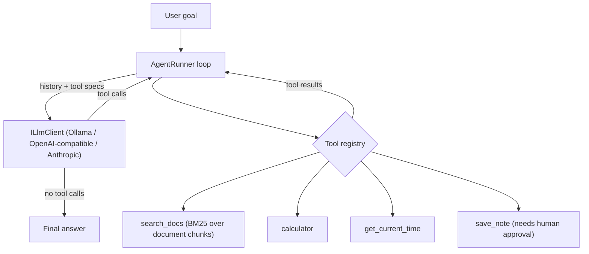

# MiniAgent - a tool-using AI agent with RAG in C#

[](https://github.com/ankitadevspace/MiniAgenticAI/actions)

A small customer-support agent that runs in your terminal. You give it a goal; the LLM decides which
tools to use, in what order, and when it is done. Built **from scratch in C# / .NET 10 with no AI
framework**, so every part of the agent loop is visible and testable.

It runs **100% free and offline** with a local model through [Ollama](https://ollama.com), and also
works with any OpenAI-compatible API (Groq, OpenRouter, Gemini, OpenAI) or Anthropic.

## What it demonstrates

| Concept | Where |
|---|---|
| **Agent loop** (think -> act -> observe -> repeat) | [`AgentRunner`](src/MiniAgent/Agent/AgentRunner.cs) |
| **Tool / function calling** | [`Tools/`](src/MiniAgent/Tools) |
| **RAG**: chunking + BM25 retrieval, exposed as a tool | [`Rag/`](src/MiniAgent/Rag), [`SearchDocsTool`](src/MiniAgent/Tools/SearchDocsTool.cs) |
| **Provider-agnostic LLM layer** (Ollama / OpenAI-compatible / Anthropic) | [`ILlmClient`](src/MiniAgent/Agent/ILlmClient.cs) |
| **Human-in-the-loop** approval for side-effecting tools | `RequiresApproval`, [`IApprovalHandler`](src/MiniAgent/Agent/IApprovalHandler.cs) |
| **Guardrails**: step limit, tool-error handling, calculator input whitelist, untrusted-tool-output prompt rule | `AgentOptions`, `AgentRunner`, `CalculatorTool` |
| **Memory**: conversation history across turns | `AgentRunner` |
| **Resilience**: retry with backoff on 429/5xx, rollback of failed turns | `HttpRetry`, `AgentRunner` |
| **Testing without an LLM**: scripted fake model + stubbed HTTP | [`tests/`](tests/MiniAgent.Tests) |

## Architecture



## Quick start (free, local)

1. Install the [.NET 10 SDK](https://dotnet.microsoft.com/download) and [Ollama](https://ollama.com).
2. Download a model that supports tool calling:
   ```bash
   ollama pull llama3.1        # ~4.7 GB. On a low-RAM machine use: ollama pull llama3.2
   ```
3. Run from the repository root:
   ```bash
   dotnet run --project src/MiniAgent
   ```
   If you pulled a different model, tell the app: `LLM_MODEL=llama3.2` (bash) or `$env:LLM_MODEL="llama3.2"` (PowerShell).

Try these (the answers come from the files in [`docs/`](docs)):

```
You> What is your refund policy?
You> How much does the Premium plan cost for a year?
You> Find the support hours and save them as a note.      <- asks your permission first
You> What is the capital of France?                        <- no tool needed
You> /reset                                                <- clears memory
```

Add your own `.txt` / `.md` files to `docs/` (or use `--docs <folder>`) to chat with your own knowledge base.

## Using other LLM providers

All configuration is through environment variables.

**Any OpenAI-compatible API** (Groq, OpenRouter, Gemini, OpenAI, ...). Several providers offer a free
tier; check their current limits and model names.
```bash
# bash
export LLM_PROVIDER=openai
export LLM_BASE_URL=https://api.groq.com/openai/v1
export LLM_MODEL=<model name from the provider's docs>
export LLM_API_KEY=<your key>
```
```powershell
# PowerShell
$env:LLM_PROVIDER="openai"
$env:LLM_BASE_URL="https://api.groq.com/openai/v1"
$env:LLM_MODEL="<model name from the provider's docs>"
$env:LLM_API_KEY="<your key>"
```

**Anthropic** (paid API key required): set `LLM_PROVIDER=anthropic` and `ANTHROPIC_API_KEY`. Optional: `LLM_MODEL`.

## Run the tests

No API key or model needed - the LLM is replaced by a scripted fake.
```bash
dotnet test tests/MiniAgent.Tests
```

## Project structure

```
src/MiniAgent/
  Agent/   AgentRunner (loop), ILlmClient + 2 provider clients, options, approval gate
  Rag/     Chunker, KnowledgeBase (BM25), DocumentLoader
  Tools/   ITool, registry, search_docs, calculator, get_current_time, save_note
  Program.cs   console app
tests/MiniAgent.Tests/   xUnit tests (loop, tools, RAG, provider wire formats)
docs/                    sample knowledge base
```

## Design decisions

- **No framework.** Semantic Kernel and similar libraries automate exactly this loop. Writing it by hand
  first means I understand what they do. The `ITool` / `ILlmClient` seams map directly onto
  Semantic Kernel plugins and `Microsoft.Extensions.AI` if I migrate.
- **Provider-neutral message model.** The loop uses its own `ChatMessage` types; each client translates
  to its wire format. Anthropic and OpenAI-style APIs differ (for example, tool results are merged into
  one user message for Anthropic, but sent as separate `tool` messages for OpenAI) and this isolates that.
- **BM25 instead of embeddings (for now).** Keyword retrieval is free, offline and deterministic, which
  keeps the project runnable with no paid service. The trade-off is that it matches words, not meaning
  ("money back" will not find "refund"). `KnowledgeBase` is the single class to swap for embeddings.
- **Tool errors go back to the model** instead of crashing the run, so the agent can retry or explain.
- **Side-effecting tools need approval; read-only tools do not.**
- **Failed turns roll back** so one network error cannot corrupt the conversation history.

## Limitations

- Small local models are less reliable at tool calling than large hosted ones. If the agent ignores
  tools, try `qwen2.5` or `llama3.1`, or a hosted OpenAI-compatible provider.
- Retrieval is keyword-based (see above); the documents are re-indexed on every start.
- Console only; the approval prompt is blocking.
- Prompt injection is mitigated by prompt rules and tool whitelisting, not eliminated.

## Roadmap

- [ ] Embeddings + vector store (Ollama `nomic-embed-text` + pgvector) with hybrid search
- [ ] ASP.NET Core Web API + background worker so the agent can run long tasks
- [ ] Persist conversations and tool traces in a database
- [ ] Evaluation set that scores answer quality
- [ ] Port the loop to Semantic Kernel and compare

## License

MIT
